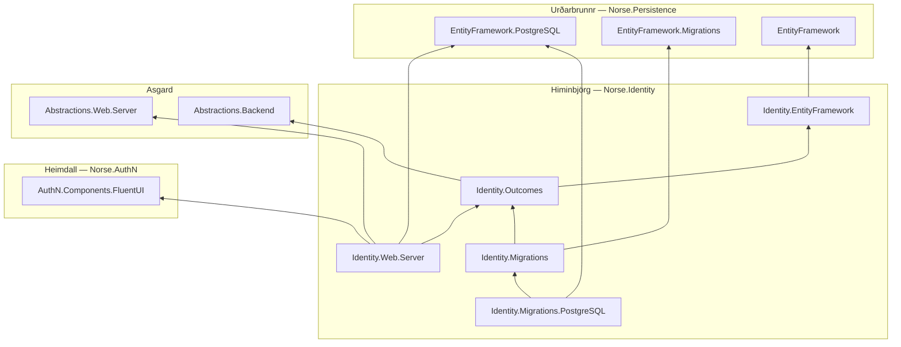

# Himinbjörg

> Himinbjörg — Heimdall's hall at the head of Bifröst.

<p align="center">
  
</p>

*Image credit: [@norsemythologyclips](https://www.instagram.com/norsemythologyclips/) — go follow them.*

The server-only identity store of the Norse Architecture, and — since PR #27 shipped `Identity.Web.Server` — its gRPC front door too: **`Norse.Identity.*`**, an EF Core model, conventions, migrations, and an `IAuthenticationService` implementation for ASP.NET Identity and OpenIddict. Entities and handlers stay server-side and never cross into WASM or MAUI — that boundary is load-bearing, not a convenience. In the dependency chain it rides on Urðarbrunnr's EF foundation and everything below, and it now also NorseRefs Heimdall's `AuthN.Components.FluentUI` — the `AuthN.Services` contract it implements arrives transitively through it, transitive-first by house law; Yggdrasil's `Hosting.Web.Server` rides on it in turn, via `AddNorseAuthenticationService`. The gRPC `AuthenticationService` is a bare `ISender` hydrate-and-send forwarder now — each method wraps Heimdall's pure wire DTO in a one-line server-sovereign command (the original `LoginCommand`/`RegisterCommand`/`EmailExistsCommand`/`LogoutCommand`, plus the anonymous tier's `TwoFactorSignInCommand`/`RecoveryCodeSignInCommand`/`ForgotPasswordCommand`/`ResetPasswordCommand`/`ConfirmEmailCommand`/`ConfirmEmailChangeCommand`/`ResendEmailConfirmationCommand`; Asgard's `CommandRequest<TRequest,TResponse>`) carrying `[Authorize]`, since the wire records themselves carry no mediator marker at all. `Account/AccountService` is the same forwarder for the signed-in account core, over eight more commands (`GetAccountStatusCommand`/`SetPhoneNumberCommand`/`ChangeEmailCommand`/`ChangePasswordCommand`/`SetPasswordCommand`/`GetExternalLoginsCommand`/`RemoveExternalLoginCommand`/`DeletePersonalDataCommand`), each behind `AuthNPolicies.Account`. One handler per command handles them and answers Asgard's shared wire shapes directly — `Outcome<NavigationResult>` for the sign-in, sign-out and other navigating operations (one server-resolved `NextUrl` the client navigates unconditionally), `Outcome<BoolResponse>` for the existence check and the acknowledgments; no result record lives on either side of the wire. They never validate inline, and their registration (handlers, Asgard's generated validator adapters, dispatch-map entries) is compile-time generated by Asgard's `AddNorseIdentityWebServerHandlers()`, not hand-written.

**PII is protected at rest and erasable by design.** `NorsePersonalDataProtector` envelope-encrypts (AES-256-GCM) every column ASP.NET Core Identity marks `[ProtectedPersonalData]` (Email, PhoneNumber, UserName), keyed per subject via Asgard's key seam and a new `subject_keys` table; blind-index HMAC columns keep lookups working without ever comparing plaintext. Erasure is a hard delete, key first: `ErasureService.ShredAsync` destroys the per-subject key (one authoritative `ErasureReceipt` per subject, however many callers race), then in one transaction deletes the subject's OpenIddict tokens and authorizations and the `users` row, whose cascade takes every child table. Every step is idempotent and every successful run does every step, so retrying until `Ok` finishes any partial failure; a commit whose acknowledgement was lost answers an honest `Indeterminate`, never `Fault`. What the temporal history keeps of an erased subject is ciphertext under a key that no longer exists. `ShredAsync` is the only way a user row leaves: the store refuses `DeleteAsync`. Live sessions die at the next revalidation, because the user is gone. `Identity.Web.Server/Disclosure/IdentityService` implements Heimdall's `IIdentityService` disclosure contract (`Norse.AuthN.Services`, Task 19a) on top of the same seam: a subject can read their own personal data back in full, a system-role caller can read anyone's in masked form, and a subject caught between key destruction and the row delete answers an honest `Erased` with the receipt; once the row is gone, live lookups answer `NotFound` until receipts persist (#55). Downloading your own personal data is now a gRPC call (`GetMyPersonalDataAsync`), materialized client-side by the ported `PersonalData.razor` page over on Heimdall; the old JSON-download scaffold endpoint here is gone, not deprecated. Deleting your own account is a gRPC call too (`AccountService`'s `DeletePersonalData`): the handler checks the password when the account has one, shreds through `ErasureService.ShredWithRetriesAsync` (three runs, because past the key's destruction the caller has no second request to retry from), and signs the caller out only once the shred has succeeded.

**Identity is system-versioned (2026-08-05), and history records only identity content (2026-10-25).** The seven tables carrying the durable identity and authorization record — `users`, `roles`, `user_claims`, `role_claims`, `user_roles`, `applications`, `scopes` — declare Urðarbrunnr's `ITemporalEntity` marker, and that is the entire adoption: PostgreSQL gets the full apparatus (`system_period`, a `{table}_history` table under a `WITHOUT OVERLAPS` primary key, hardened `SECURITY DEFINER` triggers, and a `{table}_timeline` view) emitted by the chassis into an ordinary scaffolded migration, SQL Server gets EF-native `IsTemporal()`, and no hand-written SQL exists in this repo. `NorseUser` is split across two tables: `users` carries the identity record and is versioned (on SQL Server engine-natively on the principal table alone, through the chassis's `TemporalOnPrincipalTableOnly()` opt-in), while `user_credentials` carries the password hash, security stamp, lockout state and the two blind indexes, and never is. A wrong password, a password change, a stamp rotation or a lockout therefore writes no `users` history at all — `Failed_password_writes_no_users_history` proves it on both providers. Secret stores, counters, prunable runtime state, and anything computed under a platform key stay out just as deliberately: `user_credentials`, `user_logins`, `user_tokens`, `user_passkeys`, `authorizations`, `tokens`, and `subject_keys` are never versioned, because a superseded secret must not survive in history, a login's provider key is a plaintext third-party id that can't be shredded out of it, and a temporal `DELETE` would preserve a wrapped key and make crypto-shredding reversible.

**The store writes explicitly.** `NorseUserStore` implements ASP.NET Core Identity's store interfaces directly, with no EF change tracker underneath: it reads whole users untracked, remembers what it read, and flushes only the columns that actually changed, in one transaction, never retried blindly. A commit it can't confirm answers `Indeterminate` rather than a guess. Email is the username, and the database enforces it: `user_credentials` carries a `CHECK` that the two blind indexes are equal, declared through Urðarbrunnr's fragment check-constraint seam, and registration requires a unique email. Norse code never sees an `IdentityResult` or an OpenIddict exception: handlers reach Identity and OpenIddict through `.Outcome` views (`Identity.Outcomes`, plus the `SignInManager` view in `Identity.Web.Server`) and get `Outcome<T>` back, and an IL-scanning test fails if one doesn't.

## The dependency graph

Arrows point at the thing depended on. The gate and the hall depend on each other by design — Heimdall declares the contracts and pages, Himinbjörg implements and hosts them — which is why `Identity.Web.Server` sits above Heimdall's skin here while Heimdall's own chart shows this realm riding topmost.



Dependencies are transitive-first by house law — Heimdall's `AuthN.Services` contract reaches `Identity.Web.Server` through `AuthN.Components.FluentUI`, Urðarbrunnr's base `EntityFramework` reaches it through `Identity.EntityFramework`, and `Identity.EntityFramework` itself reaches both `Identity.Web.Server` and `Identity.Migrations` through `Identity.Outcomes`, so no direct edges exist for any of them. `Identity.Outcomes` is deliberately non-web, which is what lets the migrations service use its OpenIddict view without ever referencing `Identity.Web.Server` or ASP.NET Core. Two of the NorseRefs also mount source generators (`Generator="true"`): Urðarbrunnr's `Persistence.EntityFramework` brings the entity-configuration generator into `Identity.EntityFramework`, and Asgard's `Abstractions.Web.Server` brings the registration generator that emits `AddNorseIdentityWebServerHandlers()`. `Identity.Web.Server` pins the PostgreSQL provider as its runtime provider; the migrations family stays deliberately two-provider — `Identity.Migrations.SqlServer` mirrors the PostgreSQL leg edge for edge (`Identity.Migrations` + Urðarbrunnr's `EntityFramework.SqlServer`) and is left off the chart for legibility.

## Status

**Live:** `Norse.Identity.EntityFramework`, `Norse.Identity.Outcomes`, `Norse.Identity.Web.Server`, `Norse.Identity.Migrations`, `Norse.Identity.Migrations.PostgreSQL`, and `Norse.Identity.Migrations.SqlServer` — the entity model and `NorseIdentityDbContext` sit in `Identity.EntityFramework`, a plain `Microsoft.NET.Sdk` library, so the migrations service reaches the schema without dragging the web hosting surface in behind it; `Identity.Outcomes` carries the `Outcome<T>` mapping table and the `UserManager`/OpenIddict `.Outcome` views; `Identity.Web.Server` carries the gRPC `AuthenticationService`, the disclosure surface's `IdentityService` (`Disclosure/`), `NorseUserStore`, `NorseSignInManager`, the account core's `AccountService` (`Account/`), the PII protection seam (`NorsePersonalDataProtector`/`NorseLookupProtector`/`ErasureService`), and the remaining Razor page scaffold — the two-factor and passkey pages under `/Account/Manage` and the external-login callback — still being weaned onto Heimdall's `AuthN.Components`/`AuthN.Components.FluentUI` component by component. The anonymous account tier is on gRPC: forgot/reset password, email confirmation and change, resend confirmation, and the two-factor and recovery-code sign-ins are `AuthenticationService` operations backed by mediator handlers, with the second factor carried by an opaque, data-protected challenge token rather than the partial two-factor cookie, Blazor-Server sign-ins finished through `DeferredCompletion`'s `/_auth/complete` detour, and `IRecoveryCodeReplacement` making recovery-code replacement lossless; the nine scaffold pages those operations replace are gone. The signed-in account core followed: phone number, email change, password change and set, external logins and account deletion are `AccountService` operations, and the six Manage pages they replace are gone. The store refuses to remove a passwordless account's last external login, counting under a lock on the credentials row so two concurrent removals can't both slip through (`LastSignInMethodSuite`, both providers). Linking an external login stays an HTTP round trip through the provider — `GET /Account/Manage/LinkExternalLogin?provider=` and its `LinkExternalLoginCallback`, the only Manage endpoints left, behind `AuthNPolicies.Account` — and the callback reports back with `?status=external-login-added|not-added` on its redirect, or with no status key when the link's commit outcome is indeterminate. Email delivery is still a no-op: outside `Development` the registered sender sends and logs nothing, and under `Development` `DevelopmentEmailSender` logs each link and code so a developer can follow it. The full ASP.NET Core Identity v3 + OpenIddict entity set, `NorseIdentityDbContext`, the explicit-write `NorseUserStore`, and a real EF migration (`InitialCreate`, checked in per-provider in `Identity.Migrations.PostgreSQL`/`.SqlServer`, temporal apparatus and all) stands up `norse_identity` end to end via the platform migrations service (the full story is on [Bifröst's README](https://github.com/NorseArchitecture/Bifrost#readme)). Identity was chosen as the proving vehicle for the whole migrations framework precisely because its schema is well-known and its base classes are unforgiving — if the framework survives ASP.NET Core Identity, it survives anything. Heimdall's auth surface now rides on this for real, tagged `v0.0.5` and consumed by Yggdrasil's `Hosting.Web.Server`; further curation (routes, remaining component moves) happens first via brainstorm → spec → plan, recorded in Glitnir's `docs/Himinbjorg/`.

## Migrations

```sh
dotnet tool restore
dotnet ef migrations add <Name> --project src/Identity.Migrations.PostgreSQL --startup-project src/Identity.Migrations.PostgreSQL
dotnet ef migrations add <Name> --project src/Identity.Migrations.SqlServer --startup-project src/Identity.Migrations.SqlServer
```

Both provider projects carry their own `IDesignTimeDbContextFactory`, so the commands above run fully offline — the design-time factory supplies an inert placeholder connection string and never opens a connection; actually applying migrations against a live database is the platform migrations service's job, not the CLI's. Every `migrations add`/`migrations remove` also auto-refreshes the embedded `schema/norse_identity.sql` DDL, regenerated by the platform's DDL-emitting scaffolder as part of the same command. Platform law keeps exactly one `InitialCreate` per provider until provider defaults settle — to change the schema, delete the provider project's `Migrations/` folder and re-add `InitialCreate` rather than stacking a second migration. Temporal enablement was squashed in exactly that way (2026-08-05), and so was the `user_credentials` split (2026-10-25): the folder was deleted and `InitialCreate` re-issued, so the apparatus arrives at table birth with `CREATE TABLE` rather than as a bolted-on enable transition. The squash cycle continues: `InitialCreate` is memorialized as the V1 schema only once the Heimdall gRPC conversion of the server components is complete, proven end to end with MAUI-renderable components, and the schema is settled to Buvy's satisfaction. Until then, every squash means wiping the local `norse-pg-primary`/`norse-pg-replica` volumes before the next Bifröst standup.

## The cosmos

Himinbjörg is one realm of the [Norse Architecture](https://github.com/NorseArchitecture). The whole platform composes at [Bifröst](https://github.com/NorseArchitecture/Bifrost) — clone once, cross the bridge, and every session starts there so decisions get brainstormed across the entire landscape, not in isolation. Every design is tried in [Glitnir](https://github.com/NorseArchitecture/Glitnir), the design court, before code is forged here; this realm's specs and plans will live in the court's [docs/Himinbjörg/](https://github.com/NorseArchitecture/Glitnir/tree/master/docs/Himinbjorg) once they converge.

## Soundtrack: Himinbjörg
[](https://www.youtube.com/watch?v=clUFrvQ-a4U)
